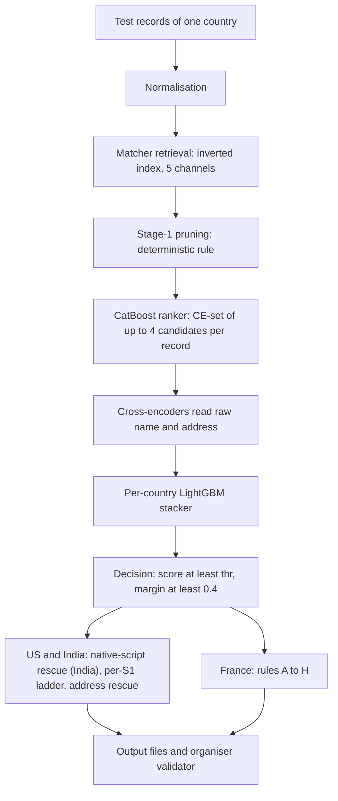

# Amazon ML Challenge 2026 — Team TITANS Business Entity Resolution

This repository presents the Team TITANS solution for the business entity resolution task of the Amazon ML Challenge 2026: each Source 2 or Source 3 record is linked to at most one Source 1 (S1) business, and the score is F0.5 per S1, macro-averaged over all S1 (a correct empty row counts as 1). The approach uses a country-specific multi-stage cascade where an inverted-index matcher and a pruning rule generate candidates, a CatBoost ranker keeps at most four per incoming record, multilingual cross-encoders read the raw name and address, and a LightGBM stacker per country accepts the best candidate only when its score and its margin over the runner-up are high enough. Two rescue retrievals for India and the US, and rules computed by code for unlabelled France, complete the decision.

| Result | Value |
|---|---|
| Public leaderboard, macro F0.5 | **0.991300** (the portal displays 0.9913); final file GXE, upload 16 of 18 |
| Candidate pairs in `candidate_pairs.tsv` | 12,293,019, i.e. 7.0954 per S1 (within-country reduction ratio 0.99999817) |
| Links in `matching_results.tsv` | 5,856,936 links for 1,632,457 S1; 100,087 S1 rows left empty |
| Recall ceiling of the CE-set (up to 4 candidates per record), train fold 9, lower to upper bound | US 98.8748 % to 99.3628 %, India 98.0572 % to 98.4831 % (matcher output: 99.3694 % and 98.5068 %) |
| Held-out train folds 9 / 8, India stacker recipe (3 of 5 seeds) with the ladder | US 0.991212 / 0.991545, India 0.990046 / 0.990298 |
| Test set | 1,732,544 S1 and 9,969,589 incoming records in the US, India and France |

The train-fold scores exclude the rescues and the France rules, the final US and India stackers are refitted on folds 6-9, folds 8 and 9 were also used to choose the thresholds and the ladder, and France has no labels, so there is no untouched end-to-end validation of the final file ([Section 5](Documentation_template.md#5-results--error-analysis)). The recall ceiling is defined in [Appendix B.2](Documentation_template.md#b2-recall-ceiling), and all 18 leaderboard uploads are listed in [Appendix B.6](Documentation_template.md#b6-leaderboard-uploads).

- [Documentation_template.md](Documentation_template.md): the full write-up (methodology, blocking, models and features, results, disclosures, worked examples).
- [code/business_entity_resolution/README.md](code/business_entity_resolution/README.md): requirements, setup and reproduction.
- [output/](output/): the submitted `matching_results.tsv` and `candidate_pairs.tsv` (stored with Git LFS).

## Approach

### Key Data Findings

The pipeline design is based on recurring patterns identified in the labelled training data ([Section 2.1](Documentation_template.md#21-problem-analysis)):

- **True copies lose information.** They drop digits or the legal suffix, abbreviate or transliterate, and use at most one rendering mode (website, brand, native script, "doing business as").
- **Decoys add plausible information.** Unowned look-alikes swap the legal form (47.5 % of US hard decoys, 0.6 % of true pairs), add a branch or industry word, or carry the house number S1 + d with d in the offset set D = {1, 2, 3, 4, 5, 7, 9, 11, 13, 21}; no shift is negative.
- **Test decoys are more frequent than train decoys.** Because decoy shifts are never negative, N(+d) − N(−d) counts decoys without labels. On the test files it gives 1.84 decoys per S1 in the US (train 0.93), 1.54 in India (train 0.77) and 1.43 in France, and the additional test decoys come in clusters of several records per S1.

The central strategy is to represent each candidate through its differences from the corresponding S1 record, and to train the stackers on a stress set with synthetic decoy clusters.

### Processing Pipeline



A country profile selects the normaliser, cross-encoders, stacker, operating point, refinements and rules; all retrieval stays within one country. [Appendix D](Documentation_template.md#d-worked-examples) follows three test records through every stage.

1. **Normalisation.** For the US and India: lower case, `&` to `and`, punctuation to spaces, state names and street abbreviations mapped, and non-Latin name tokens transliterated with an Indic-to-Latin lexicon learned from train positives. France adds French rules: region, department and city components learned from the test files, `15B` split to `15 bis`, street types and their typos canonicalised, and dotted or leet legal forms collapsed (S.A.R.L. and 5arl to sarl). The cross-encoders read the raw text instead.
2. **Matcher retrieval (stage 0).** A C++17/OpenMP inverted index over the S1 records of the country, with five channels: name tokens, address tokens, character 4-grams and 3-grams of the core name, and phonetic 4-grams. Per incoming record it keeps the top 12 by total score, the top 6 by name score, the top 6 by address score and every S1 with the same core-name token set (if at most 2,000 S1 share it), and computes 76 pair features.
3. **Stage-1 pruning.** A rule with six clauses and no model (best total; total at least 0.6 × max(1, best total); best address score; address coverage of at least 0.95; a name of at most 3 characters with coverage of at least 0.4; the same core name with coverage of at least 0.3) keeps 37,614,782 pairs, 21.71 per S1. In the blocking study the owner survived stage 1 for 99.974 % of the fold-8/9 records, and fold-9 macro F0.5 moved from 0.990117 to 0.990086.
4. **CatBoost ranker and CE-set (stage 2).** The ranker scores the kept pairs on the 76 matcher features. The CE-set keeps the top-ranked pair of every incoming record, and ranks 2-4 when their probability is at least 0.001: 11,687,317 pairs. This cap of four is the largest recall loss of the cascade.
5. **Cross-encoders.** Fine-tuned MiniLM-L12 and multilingual-e5-base models read the raw `name | address` pair (up to 128 tokens) and give one logit. The US and India use `ce_v1` and `ce_e5`; for France the blend 0.35 `ce_v1` + 0.15 `ce_v1fr` + 0.5 `ce_e5fr` fills the stacker's cross-encoder slot.
6. **Per-country LightGBM stackers.** 158 to 217 features per pair: number deltas, added, dropped and replaced tokens with their IDF and semantic similarity, the legal-form relation, cross-encoder logits, ranker scores and competition features. The US and India stackers are trained on the stress universe: unowned train records with a +d house-number shift to their top S1 receive 0, 1 or 2 clones (copy, legal-form, word or swap mutations, jittered logits), with cluster sizes and rates set from label-free counts on the US test records. The France stacker uses the normal universe without clones.
7. **Decision.** Per incoming record, the best candidate is accepted if its score is at least thr and its margin over the second-best is at least 0.4. thr is 0.75 for the US and India and 0.82 for France, a more conservative point set without French labels.
8. **Refinements.** US and India, in this order: the India native-script rescue (+9,759 links), the per-S1 ladder, which re-decides each record by the number k of other records accepted for the same S1 (thresholds 0.75 / 0.68 / 0.72 / 0.77 for k = 0 / 1 / 2 / 3 or more; US +277 / −284, India +247 / −248), and the address rescue for records still unlinked (US +192, India +2,945). France: rules A-H, which turn 887,630 stacker accepts into 867,559 links.
9. **Output.** Both files have one row per test S1. `candidate_pairs.tsv` is the CE-set plus the rescue candidates not already in it; the export asserts that every matched pair is a candidate pair, and the last stage runs the organisers' validator with `--check-ids`.

Details: [Section 3](Documentation_template.md#3-candidate-generation-blocking) for blocking and [Section 4](Documentation_template.md#4-matching-model-model-architecture-and-feature-engineering) for models, features and thresholds.

## Model Components

Every model used by the final pipeline. The ranker, stackers and rescue models are trained from scratch on the provided data; stacker training uses the train records with a candidate in S1 folds 6-9 (the France and default stackers are fitted on folds 6-7 with early stopping on fold 8), and the US/India thresholds are tuned for exact per-S1 macro F0.5 on labelled train folds.

| Model | Type / base model | Trained on | Role in the pipeline |
|---|---|---|---|
| First-stage ranker | CatBoost (Logloss, depth 7, up to 1,600 trees, GPU) on the 76 matcher features | 140,000 train incoming records of S1 folds 0-5; early stopping on fold 6 | Stage-2 pruning to the CE-set; its probability and rank are stacker inputs |
| `ce_v1` | Cross-encoder, MiniLM-L12 | Labelled US/India train pairs of folds 0-5: hard records plus a random 25 % of the others | Pair logit in all countries; weight 0.35 in the France blend |
| `ce_e5` | Cross-encoder, multilingual-e5-base | The same pairs as `ce_v1` | Second pair logit for the US and India; starting point of `ce_e5fr` |
| `ce_v1fr` | `ce_v1` fine-tuned | French test pseudo-labels from a first-generation run (up to 250,000 positives, 150,000 decoy and 100,000 hard negatives) plus 500,000 labelled US/India pairs | French reader, weight 0.15 in the France blend |
| `ce_e5fr` | `ce_e5` fine-tuned, 7,419 steps | 474,808 French pairs pseudo-labelled by the confidence of `ce_v1` and `ce_v1fr`, plus 474,808 labelled US/India pairs | French reader, weight 0.5 in the France blend |
| US stacker `robust2_S5` | LightGBM, mean of seeds 1-5, 217 features | US rows of the stress universe | US accept/reject decision (thr 0.75, then the ladder) |
| India stacker `robust2_G5` | LightGBM, mean of seeds 1-5, 211 features | Stress universe, US and India rows | India decision (thr 0.75, then the ladder) |
| France stacker `fr_G5` | LightGBM, mean of seeds 1-5, 158 features | Normal universe (without clones), US and India rows | France decision (thr 0.82); its best and second-best scores feed rules A-H |
| Default stacker `fr_G` | LightGBM, single fit, 158 features | As `fr_G5` | Country labels without a profile, with `ce_v1` only; the provided test set has none |
| India native-script rescue model | LightGBM | India rescue candidates of train folds 0-7, retrieved with lexicons that leave out the record's own fold | Links an unlinked native-script record to the best of its top 5 rescue candidates (score at least 0.88, margin at least 0.3) |
| Address-rescue filter | LightGBM, 10 features | Per country, address-retrieval pairs of train records that the main decision leaves unlinked, folds 6-7 | Keeps at most 2 of the top 3 address-retrieval candidates per unlinked US/India record |
| Address-rescue scorer | LightGBM, 41 features, mean of seeds 7, 8, 9 | The same pairs as the filter | Links the best kept pair (US thr 0.86, margin 0.0; India thr 0.66, margin 0.1) |
| `sentence-transformers/paraphrase-multilingual-MiniLM-L12-v2` | Pretrained encoder, Apache-2.0, 117,653,760 parameters | Not trained by the team | Base of `ce_v1` and `ce_v1fr`, tokenizer of all cross-encoders, and, without fine-tuning, the token encoder of the `g_sem_*` features |
| `intfloat/multilingual-e5-base` | Pretrained encoder, MIT, 278,043,648 parameters | Not trained by the team | Base of `ce_e5` and `ce_e5fr` |

The cross-encoders encode `name | address` with the MiniLM tokenizer, masked mean pooling and a linear head, trained for one epoch with binary cross-entropy. Pinned revisions and library licences are in [Appendix B.5](Documentation_template.md#b5-pretrained-models-and-licences).

**Features.** The stacker features fall into three families: name features (matcher string similarities, n-gram and phonetic overlaps, cross-encoder logits, the generic token-difference features `g_tok_*` and `g_sem_*`, the legal-form relation `legal_rel`), address features (matcher address statistics, the relation of unmatched digit runs, the generic number features `g_num_*`) and context features (ranker probability and rank, margins and group maxima per incoming record, competition features, and for the US and India collective features over the records competing for the same S1). India uses 211 features (a 203-feature base list − 21 excluded + 25 generic pair features + 4 collective counts), the US 217 (the India list + 6 collective value features), and France and the default route 158 (a 149-feature base list − 16 excluded + 25 generic pair features). The 21 excluded features are derived from the offset set D or from the decoy operations (15, for example `num_isD` and `rb_isD`) or are related to them (6, for example `num_sub`); they are listed in [`src/pipeline/clean/gen_stack.py`](code/business_entity_resolution/src/pipeline/clean/gen_stack.py), whose `check()` asserts that none of them is an input of a final stacker.

## France Post-Processing Rules A-H

France has no labels, so after the `fr_G5` decision (887,630 accepted links) eight rules computed by code from the stacker scores, the raw text and the address adjust the links, in this order; they act on France CE-set pairs only and add no candidate ([Appendix B.3](Documentation_template.md#b3-france-rules-a-h-in-the-final-run)):

| Rule | What it does | Count in the final run |
|---|---|---|
| A, category-swap veto | Drops an accepted link at the same address when the S1 name lost a core word and the incoming name gained a category word | A and B together: −29,021 |
| B, substitution veto and rescue | Drops links where one S1 word was replaced by a frequent word at the same address; rescues unlinked records with a true-like name difference and a best score between 0.4 and the France threshold | +5,272 rescued |
| C, residual rescue | Links "S1 name + associes" or "S1 name + one generic suffix" on the same street when the top candidate is the only compatible S1 | +5,846 |
| D, street veto | Drops a link when all street-name tokens of the S1 are absent from the incoming address, allowing typos | −826 |
| E, generic-word swap veto | Drops a link where "compagnie" or "services" replaces a non-generic S1 word before the legal form, same address | −538 |
| F, generic-word rescue | Links low-scoring records whose name is the S1 name plus "groupe", or with one word replaced by "groupe" or "developpement", at the same address | +332 |
| G, cell veto | Drops links in 7 address × name cells, for example a +d house-number shift combined with a name mutation | −1,322 |
| H, acronym rescue | Links a record whose name holds an initials variant of the S1 name, at the same address, when that S1 is the only one there with such a variant | +186 |

After the France post-processing sequence, the reported output contains 867,559 French links. The counts are actions in execution order, not per-rule accuracies.

## Decision Examples

Condensed from [Appendix D](Documentation_template.md#d-worked-examples), which has the full traces. Test labels are private, so these examples show how the pipeline decides, not whether a link is correct.

**US, legal-form look-alikes ([D.1](Documentation_template.md#d1-us-legal-form-and-word-look-alikes)).** Incoming record S2-672512509, "Legacy Marketing Enterprises (Inc)", has no address, so only the name separates its four candidates:

| S1 candidate | Stacker score | Difference from the incoming name |
|---|---|---|
| Legacy Marketing Enterprises Inc (Windsor, CT) | **0.965022** | none; same legal form |
| Legacy Marketing Enterprises LLC (Irondequoit, NY) | 0.000007 | legal form Inc to LLC |
| Legacy Marketing Enterprises PC (Joshua Tree, CA) | 0.088664 | legal form Inc to PC |
| Legacy Marketing Industries Inc (Louisville, TN) | 0.000088 | one word replaced in place |

The generic token features ignore legal-form tokens, so the legal-form features and the cross-encoders separate the three "Enterprises" names, and the word-replacement features mark "Industries"; the LLC record, ranked second by the ranker, gets the lowest stacker score. The best score passes thr 0.75 with a margin of 0.876, so the record is linked to the Windsor S1 (S1-158550741) only.

**India, native-script rescue ([D.2](Documentation_template.md#d2-india-native-script-rescue)).** Incoming record S3-309374692, "विजय एंटरप्राइजेज प्राइवेट लिमिटेड", address "24/11, Mumbai, महाराष्ट्र". The Latin index finds three "Vijay Enterprises Private Limited" businesses in Agra, Satara and Byculla, but all score below 1e-5 and the record stays unlinked. The rescue transliterates the name with the lexicon learned from train positives to the key (vijay, enterprises), finds 10 S1 records with that core name in Maharashtra and keeps the top 5. The rescue model scores S1-643758988 in Ghatkopar, Mumbai, the only rescue candidate with the house number 24/11, at 0.99994 against 0.0000191 for the next one, above the rescue threshold 0.88 and margin 0.3, so the link is added.

**France, rules A and B veto ([D.3](Documentation_template.md#d3-france-category-word-swap-vetoed-by-rules-a-and-b)).** Incoming record S2-30376547, "TQ COMITE SARL", "2 R SUZANNE LENGLEN, NANTES", has two candidates. The S1 with the identical name, "TQ Comite SARL" in Pessac, gets +7.1 from `ce_v1` but a blended logit of −3.2 and a stacker score of 0.000098. "TQ Parents SARL" at 2 Rue Suzanne Lenglen, Nantes, gets 0.999837 and is accepted (thr 0.82). Rule A then fires: same house number and street, the S1 lost the core word "parents" and the incoming name gained the category word "comite"; rule B also lists the pair. The link is dropped, and no later rule links the record again.

## Project Structure

```text
.
├── README.md                          this page
├── Documentation_template.md          full write-up (organiser template, appendices A-D)
├── code/business_entity_resolution/
│   ├── README.md                      requirements, setup, run, verification
│   ├── requirements.txt               pinned Python packages
│   └── src/
│       ├── run_all.sh                 entry point: training stages t0-t9, inference stages i1-i8
│       ├── download_models.py         download of the two pretrained encoders
│       ├── pipeline/                  normalisation, blocking, cross-encoders, features, stackers, rescues, France rules, inference
│       ├── work/                      C++ matcher, v6 normalisation, ranker training; place for the organisers' data
│       ├── artifacts/                 shipped ce_e5fr logits
│       ├── evidence/                  reports and logs of the submitted run and of the checks cited in the documentation
│       └── analysis/                  exploration scripts (not run by run_all.sh)
└── output/
    ├── matching_results.tsv           submitted file (Git LFS)
    └── candidate_pairs.tsv            submitted file (Git LFS)
```

## Reproducing the Pipeline

With the organisers' data copied into `src/work/student_resource/`, run from `code/business_entity_resolution/`:

```sh
E5FR_RETRAIN=1 sh src/run_all.sh
```

This retrains every model and runs inference. It was tested on Windows 11 with Git Bash (Linux was not tested) and needs Python 3.11, `g++` with OpenMP, an NVIDIA GPU (CUDA 12.4; tested on an RTX 4070 Ti SUPER, 16 GB), about 70 GB of free disk and about 11 h 30 min on the tested machine. GPU training is not bit-deterministic, so the files come out very close to the submitted ones but not byte-identical (a clean run reproduced 99.82 % of the submitted links). Setup, the commands for PowerShell and Command Prompt, and the output hashes are in the [code README](code/business_entity_resolution/README.md).

## Model Artifacts

The trained models are not stored in this repository. They are available as one archive in a private Google Drive folder; access on request:

| Item | Value |

| File | `TITANS_full_with_models.zip`, 3,285,958,103 bytes |
| sha256 | `38959ba2656687adc21eb245695a049d4202d9137c57496e868e2773a67bc00d` |

The archive holds the code, the trained weights, the two pretrained encoders and the stored cross-encoder logits of the submitted run. The `ce_e5fr` weights were deleted after scoring; its logits on the France CE-set ship with the code in `src/artifacts/`. On 29 September 2026 a fresh extraction of the archive, with the organisers' data added, ran the inference-only command

```sh
sh src/run_all.sh t0 t2 i1 i2 i3 i3b i4 i5 i6 i6b i7 i8
```

with `E5FR_RETRAIN` unset and reproduced both output files byte for byte (`matching_results.tsv` sha256 `9183e542...`, `candidate_pairs.tsv` `e7b4c679...`); the CE-set checkpoints and stacker scores were identical, and the organiser validator returned PASS. Step-by-step instructions are in `EXACT_REPRODUCTION.md` inside the archive.

## Implementation Notes

The disclosures are listed in full in [Appendix C](Documentation_template.md#c-disclosures), which also states where the offset set D is still used and which earlier stackers selected the training records of the rescue models. In short:

- The pipeline computes unsupervised statistics on the unlabelled test files (IDF, blocking indexes, competition features, the India lexicon, French geography) and self-trains the French readers `ce_v1fr` and `ce_e5fr` on pseudo-labels of French test pairs. Label-free counts on the test records also set the stress-clone rates, the France operating point and the weight of `ce_v1fr` in the French blend. During development, a synthetic labelled French proxy generated from the French test S1 records was used for evaluation (guard H).
- France rules A-H were designed after analysing the unlabelled French test records, including AI-assisted review of sampled pairs, and their parameters were chosen after seeing test results, including public-leaderboard results. Each rule is computed by code; no test label and no human or LLM assessment of a pair is an input to the pipeline.
- The French reader `ce_e5fr` is used although it failed two of its written acceptance checks, guard H and the integration rule ([Appendix B.4](Documentation_template.md#b4-acceptance-checks-of-the-french-reader-ce_e5fr)).
- The final file was chosen among the uploads using public-leaderboard scores, which were also used for a French diagnostic upload and to calibrate the label-free estimates for the US address rescue and rule F; the rule-F estimates then selected two further rule-F families.
- AI coding assistants wrote and ran code and analysis scripts during development; for the three later rule changes (the rule-G cells, rule H and rule F's lower bound) they also chose the cells and thresholds and wrote the rule code, which the team adopted.
- No external data, lookup, geocoder or API is used (hand-written lists are limited to small word lists), no LLM runs in the pipeline, and every model has at most 8B parameters.

## TITANS Team

Christopher A 
dharun Raj J B 
Gokul K
Ajaykumar S 
